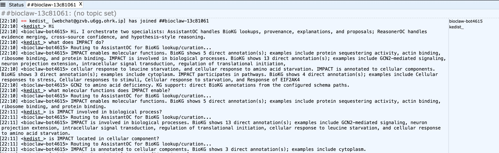
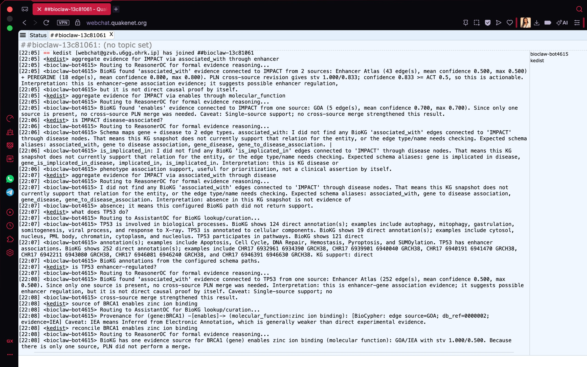

# IRC Demonstration Record

These are original captures of the conversational BioClaw prototype on
`main`, recovered from the project presentation assets. They are historical
workflow evidence, not captures of the `symbolic` CLI or a new live deployment.

## AssistantOC: Grounded Retrieval

The user asks what IMPACT does, which molecular functions it enables, which
processes it is involved in, and where it is annotated in the cell. The bot
shows its delegation to AssistantOC before returning KG-backed annotations.

What an evaluator can observe: role routing, a broad summary, targeted
questions, and named annotation examples.

## ReasonerOC: Source Support And Provenance

The capture includes enhancer source aggregation for IMPACT, single-source
GOA support, disease-relation coverage, a TP53 summary, and BRCA1 zinc-ion-binding
provenance/reconciliation.

What an evaluator can observe: routing to different specialists, explicit
source names, single-source caveats, and the GOA/IEA provenance path.

## Read The Captures In Context

- Counts and STVs are the outputs of the captured dataset and policy version.
  Later score handling changed; the displayed numbers are not current defaults.
- The enhancer example aggregates source-level support over neighboring edges.
  It does not demonstrate that each enhancer-gene pair has independent
  corroborating estimates.
- The word `actionable` is a configured policy label. It is not a calibrated
  probability or proof of causality.
- The missing disease examples show the queried snapshot's coverage. They do
  not disprove disease associations outside that snapshot.
- The captions do not endorse every historical sentence. For example, an
  interpretation in the disease section refers to association support even
  though the preceding query returned no edges; review empty-result handling
  in a live evaluation.
- These captures do not demonstrate typo correction, persistent project
  management, or semantic-parser orchestration.

Open either image at full resolution to read the IRC transcript. For
reproducible checks, follow the [evaluation guide](evaluation.md).
